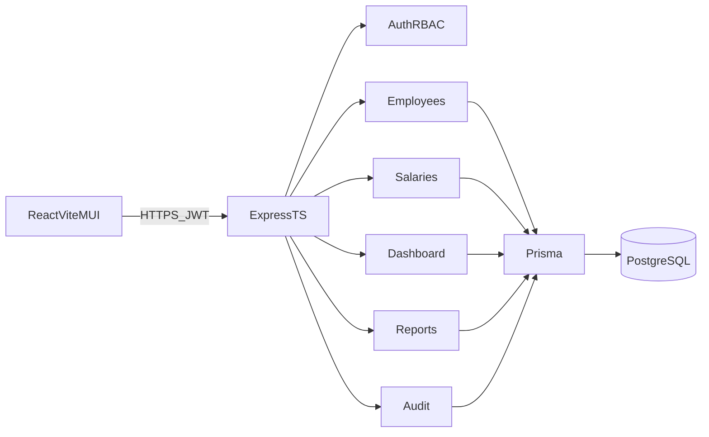

# Architecture

## Overview

ACME is a **monorepo** HR Salary Intelligence Platform:

| Area | Stack |
|------|--------|
| Frontend | React + TypeScript + Vite + MUI + React Router + TanStack Query + RHF + Zod + Recharts + Axios |
| Backend | Node.js + Express + TypeScript + Prisma |
| Database | PostgreSQL |
| Auth | JWT + bcrypt + RBAC |
| Deploy | Frontend → Vercel; Backend → Render; DB → managed PostgreSQL |



## Repository layout

```
/
  backend/          Express API, Prisma, seeds, tests
  frontend/         Vite React SPA
  docs/             Product and engineering documentation
  README.md
```

## Backend

### Structure

```
backend/src/
  config/           env, cors, db, logger
  middleware/       auth, rbac, validate, rateLimit, errorHandler
  modules/
    auth/
    employees/
    salaries/
    dashboard/
    reports/
    audit/
    departments/
    countries/
  utils/
  app.ts
  server.ts
```

Each module: `controller` → `service` → Prisma; plus `routes`, `validation` (Zod), and tests. **Business logic lives in services**, not controllers.

### Cross-cutting

- Centralized error handling and structured logging.
- Request validation on all mutating/query inputs.
- Consistent API envelope: `{ success, data, error, meta }` (`meta` for pagination).
- Database transactions for salary revisions (close period → insert → revision → audit).
- Health: `GET /api/health`.

### Security

- Protect all private routes with JWT verification.
- RBAC middleware per route/action.
- Helmet secure headers; CORS allowlist from env.
- Login rate limiting; bcrypt for passwords; never return password hashes.
- Secrets (`JWT_SECRET`, `DATABASE_URL`) only from environment.

### RBAC summary

| Role | Employees | Salaries | Dashboard/Reports | Audit | Exports |
|------|-----------|----------|-------------------|-------|---------|
| SUPER_ADMIN | Full | Full | Full | Full | Full |
| HR_MANAGER | Full | Full | Full | Read | Full |
| HR_EXECUTIVE | CRUD | Read only | Read | No | No salary mutation exports |
| VIEWER | Read | Read (permitted fields) | Read | No | No |

## Frontend

```
frontend/src/
  components/       shared UI (table, KPI, dialogs, skeletons)
  layouts/          app shell: sidebar, header
  pages/
  features/         auth, employees, salaries, dashboard, reports, audit
  hooks/
  services/         typed Axios clients
  types/
  utils/
  routes/           public + protected route config
  theme/            ACME MUI theme tokens
```

- Auth state centralized; Axios attaches Bearer token; 401 clears session.
- Protected routes by auth + role.
- TanStack Query for server state; React Hook Form + Zod for forms.
- Server-side pagination/filters only (never load all 10k rows).
- Loading skeletons, empty states, error states, confirmation dialogs.

### Navigation (app shell)

Sidebar: Dashboard, Employees, Salary Management, Salary History, Reports, Audit Logs, Settings.  
Header: ACME branding, global search, notifications placeholder, user profile, logout.

## Data flow (salary update)

1. Authenticated client submits revision (role must allow).
2. Service validates amounts, currency, effective dates, no overlap.
3. Transaction: set `effective_to` on current open record → insert new `salary_records` → insert `salary_revisions` → insert `audit_logs`.
4. Response returns new current salary + revision id.

## Observability & ops

- Structured logs (request id, user id, route).
- Health check for deploy probes.
- Connection pooling via Prisma; indexes documented in database design.
