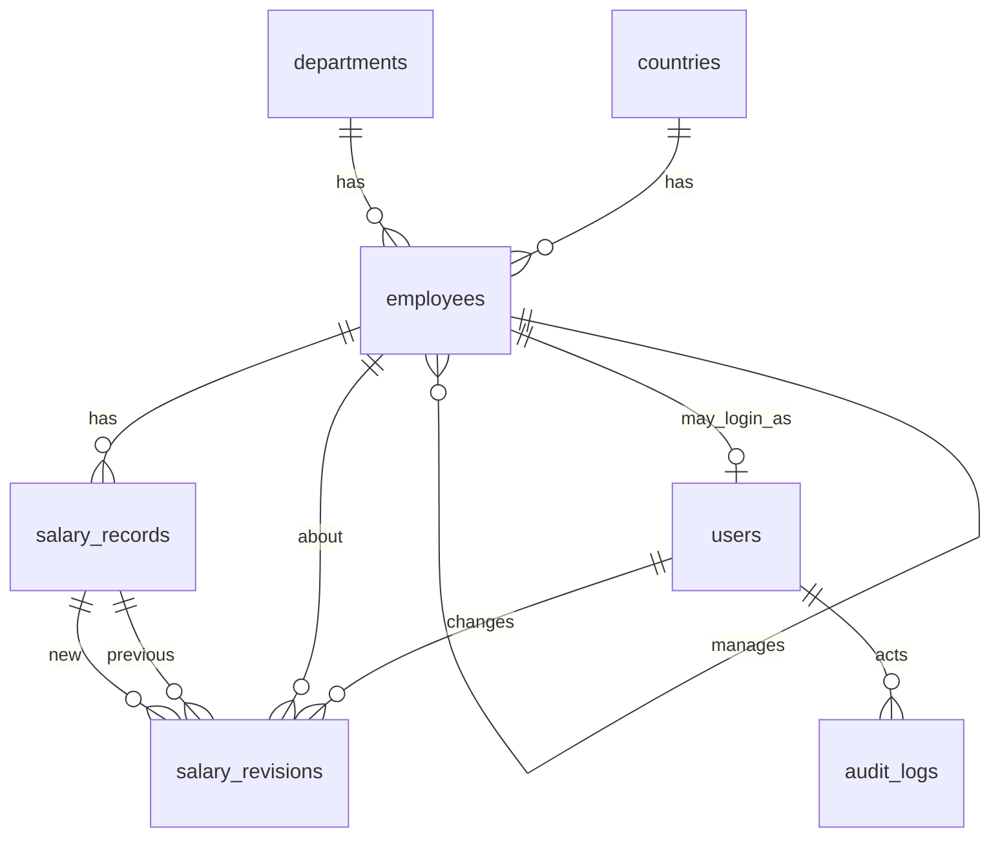

# Database Design

## Goals

Normalized PostgreSQL schema for ~10,000 employees with auditable salary history, currency-safe analytics, and efficient server-side filtering/pagination.

## Entity relationship



## Tables

### `countries`

| Column | Type | Notes |
|--------|------|--------|
| id | UUID PK | |
| code | VARCHAR(3) UNIQUE | ISO-style country code |
| name | VARCHAR(100) | |
| currency_code | CHAR(3) | ISO 4217 (e.g. USD, INR, EUR) |
| created_at / updated_at | TIMESTAMPTZ | |

### `departments`

| Column | Type | Notes |
|--------|------|--------|
| id | UUID PK | |
| code | VARCHAR(32) UNIQUE | |
| name | VARCHAR(100) | |
| is_active | BOOLEAN | default true |
| created_at / updated_at | TIMESTAMPTZ | |

### `employees`

| Column | Type | Notes |
|--------|------|--------|
| id | UUID PK | |
| employee_code | VARCHAR(32) UNIQUE | e.g. ACME-000001 |
| first_name | VARCHAR(100) | |
| last_name | VARCHAR(100) | |
| email | VARCHAR(255) UNIQUE | |
| phone | VARCHAR(32) NULL | |
| department_id | UUID FK → departments | |
| designation | VARCHAR(100) | |
| country_id | UUID FK → countries | |
| city | VARCHAR(100) | |
| joining_date | DATE | |
| employment_status | ENUM | `ACTIVE`, `INACTIVE` |
| manager_id | UUID NULL FK → employees | self-reference |
| created_at / updated_at | TIMESTAMPTZ | |

### `users`

| Column | Type | Notes |
|--------|------|--------|
| id | UUID PK | |
| email | VARCHAR(255) UNIQUE | login identity |
| password_hash | TEXT | bcrypt; never exposed in APIs |
| role | ENUM | `SUPER_ADMIN`, `HR_MANAGER`, `HR_EXECUTIVE`, `VIEWER` |
| employee_id | UUID NULL UNIQUE FK → employees | optional link |
| is_active | BOOLEAN | default true |
| created_at / updated_at | TIMESTAMPTZ | |

### `salary_records`

| Column | Type | Notes |
|--------|------|--------|
| id | UUID PK | |
| employee_id | UUID FK → employees | |
| base_salary | NUMERIC(14,2) | |
| bonus | NUMERIC(14,2) | default 0 |
| allowances | NUMERIC(14,2) | default 0 |
| deductions | NUMERIC(14,2) | default 0 |
| currency | CHAR(3) | must match operational currency for the record |
| effective_from | DATE | inclusive |
| effective_to | DATE NULL | exclusive end; NULL = currently open |
| created_at / updated_at | TIMESTAMPTZ | |

**Computed (application layer, not stored as source of truth):**

- Gross = base_salary + bonus + allowances  
- Net = Gross − deductions  

Monetary values use **Decimal/NUMERIC**, never floating-point.

### `salary_revisions`

| Column | Type | Notes |
|--------|------|--------|
| id | UUID PK | |
| employee_id | UUID FK → employees | |
| previous_record_id | UUID NULL FK → salary_records | null on first salary |
| new_record_id | UUID FK → salary_records | |
| changed_by | UUID FK → users | |
| change_reason | TEXT NULL | |
| created_at | TIMESTAMPTZ | |

Preserves traceability: who changed what, when, and which records were closed/opened.

### `audit_logs`

| Column | Type | Notes |
|--------|------|--------|
| id | UUID PK | |
| actor_user_id | UUID NULL FK → users | null if system |
| action | VARCHAR(64) | e.g. `SALARY_UPDATE`, `EMPLOYEE_CREATE` |
| entity_type | VARCHAR(64) | e.g. `salary_record`, `employee` |
| entity_id | UUID | |
| before_json | JSONB NULL | |
| after_json | JSONB NULL | |
| ip_address | VARCHAR(64) NULL | |
| created_at | TIMESTAMPTZ | |

## Integrity rules

1. **Unique** `employees.employee_code`, `employees.email`, `users.email`.
2. **One open salary period per employee:** at most one row with `effective_to IS NULL` per `employee_id` (partial unique index).
3. **No overlapping periods** for the same employee: enforced in the salary service inside a transaction; reject if new `[effective_from, effective_to)` intersects an existing period.
4. **Never aggregate different currencies** into a single financial KPI; group by `currency` (and filters).
5. **Salary updates must not overwrite history:** close current open row (`effective_to`), insert new row, write `salary_revisions` + `audit_logs` in one transaction.
6. Non-negative monetary fields validated at API layer (`base_salary > 0` or `>= 0` per product rule; deductions/bonus/allowances `>= 0`).

## Indexes (performance)

| Table | Index | Purpose |
|-------|--------|---------|
| employees | `(employee_code)`, `(email)` | uniqueness + lookup |
| employees | `(last_name, first_name)` | name sort/search |
| employees | `(department_id)`, `(country_id)`, `(employment_status)`, `(designation)` | filters |
| employees | `(joining_date)` | sort |
| salary_records | `(employee_id, effective_from DESC)` | current + history |
| salary_records | partial unique `(employee_id) WHERE effective_to IS NULL` | one active record |
| salary_records | `(currency)`, `(effective_from)` | payroll aggregations |
| salary_revisions | `(employee_id, created_at DESC)` | history UI |
| salary_revisions | `(created_at)` | monthly revision trends |
| audit_logs | `(entity_type, entity_id)`, `(created_at DESC)`, `(actor_user_id)` | audit queries |

## Salary update transaction (canonical)

```
BEGIN
  SELECT current open salary_record FOR UPDATE
  VALIDATE no overlap / amounts / role
  UPDATE current SET effective_to = :day_before_new_from
  INSERT new salary_record (effective_to NULL)
  INSERT salary_revision (previous, new, changed_by)
  INSERT audit_log (before, after)
COMMIT
```

## Seed expectations

- Deterministic RNG with fixed seed.
- Exactly 10,000 employees; multiple countries, departments, designations, currencies, statuses.
- One salary record (open) per seeded employee; optional prior closed records for history demos.
- Initial HR Manager (and optionally Super Admin) user via upsert — **idempotent** re-runs without duplicates.
